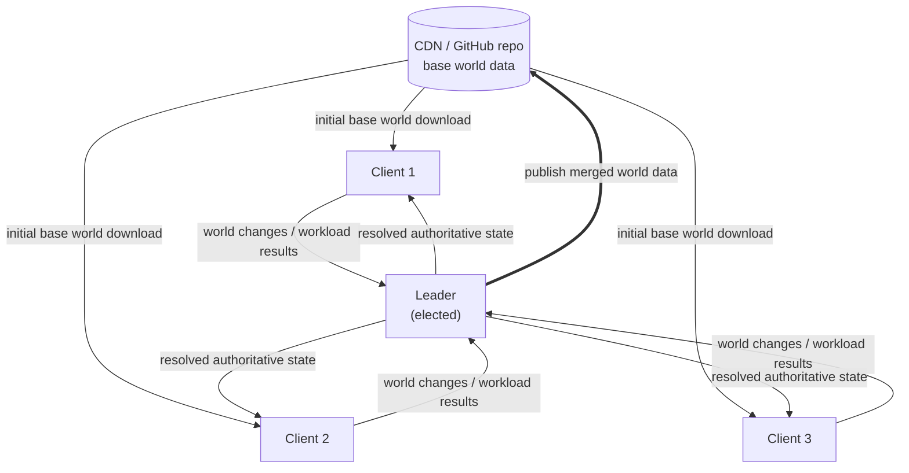
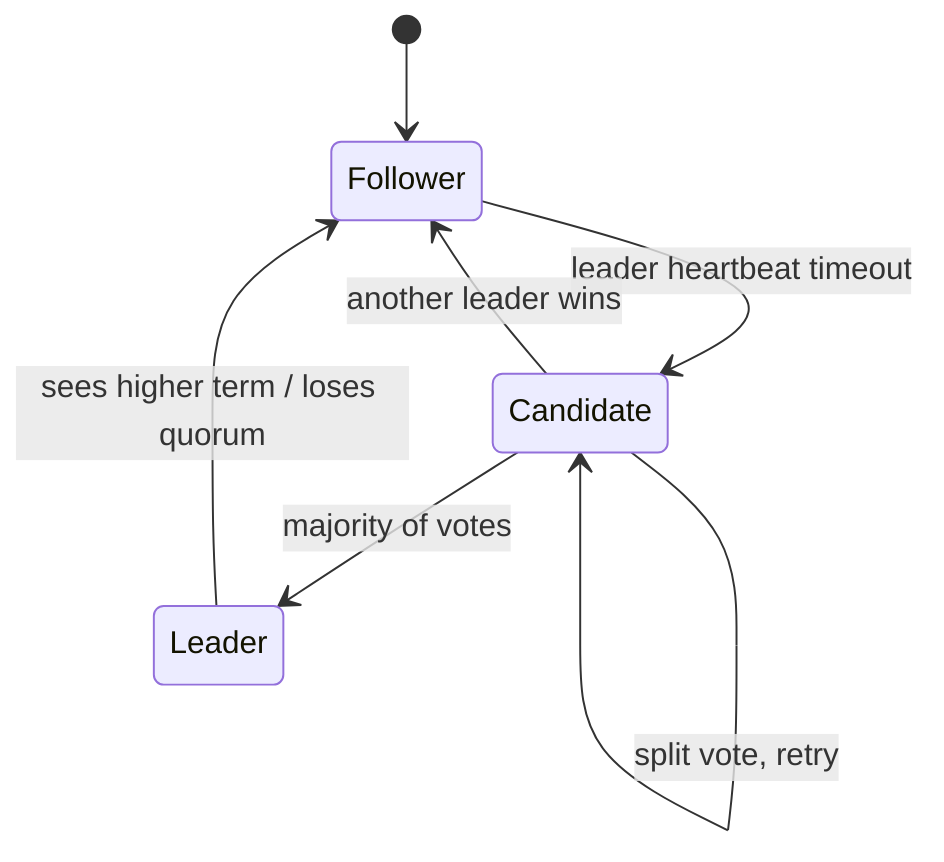
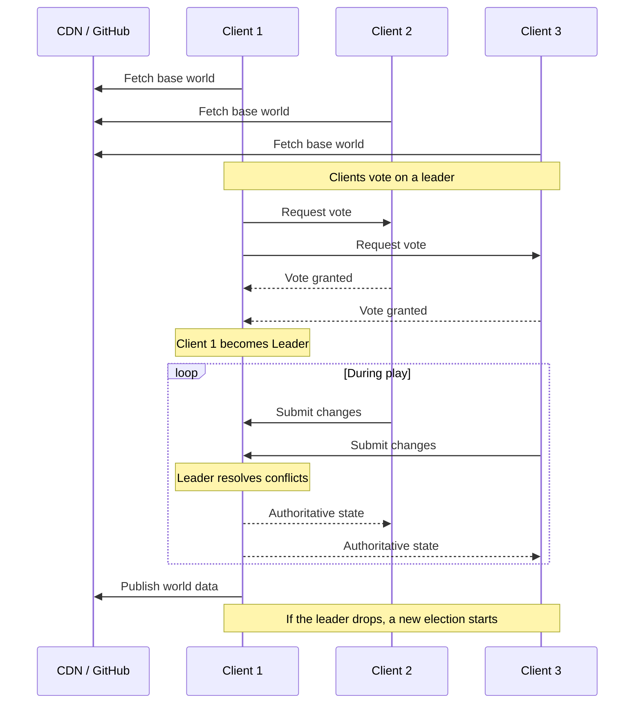

# uvmc-p2p Infrastructure

uvmc-p2p is a NeoForge mod for Minecraft 1.21.11 that allows fully P2P world sharing, with a CDN or GitHub repository in the middle.

This document describes how the pieces fit together. It is a draft: anything marked 🟡**TODO** is not decided yet.

## Overview

A world session consists of three roles:

| Role | Description |
| --- | --- |
| **CDN / GitHub repository** | Stores the base world data. Clients download it when joining; the leader publishes merged world data back to it. |
| **Client** | Any player running the mod. Downloads the base world and shares the workload with the other connected clients. |
| **Leader** | A client elected by the other clients. Resolves conflicts and is the only one that transmits data to the CDN. |

Players play simultaneously (live multiplayer). The CDN is not in the gameplay path; it only holds the base world and receives published updates.

## Architecture

## Leader election

Leader election follows the Consul approach: the connected clients vote on a leader, and the winner transmits data to the CDN.

- Clients start as followers.
- If a follower stops hearing from the leader, it becomes a candidate and requests votes.
- A candidate with a majority becomes leader.
- If the leader drops, a new election starts.

🟡**TODO: Peer discovery.** How do clients find each other before the first election (session code, invite, tracker file in the repo)? Is NAT traversal or a relay needed?

🟡**TODO: Leader failure.** What happens to unpublished changes if the leader crashes mid-session?

🟡**TODO: Leader handover.** Does a new leader rebuild state from followers or from the last CDN snapshot?

## Session flow

## Responsibilities

### CDN / GitHub repository
- Stores the base world data.
- Receives merged world data from the leader.
- Is never written to by regular clients.

### Clients
- Download the base world from the CDN on join.
- Share the workload with the other connected clients.
- Send world changes and workload results to the leader.
- Take part in leader elections.

🟡**TODO: Workload sharing.** What exactly is split across clients (chunk generation, entity ticking, region simulation)?

### Leader
- Resolves conflicts between clients; the leader's decision is authoritative.
- Sends the resolved state back to the clients.
- Is the only node that transmits data to the CDN.

🟡**TODO: Publish timing.** Does the leader push to the CDN on an interval, on save, or on exit?

🟡 **TODO: Integrated server.** Does the leader act as the integrated server that other clients connect to like a normal Minecraft server?
